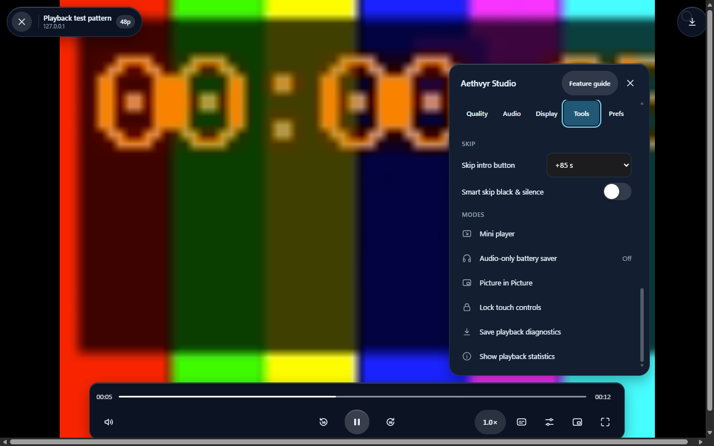
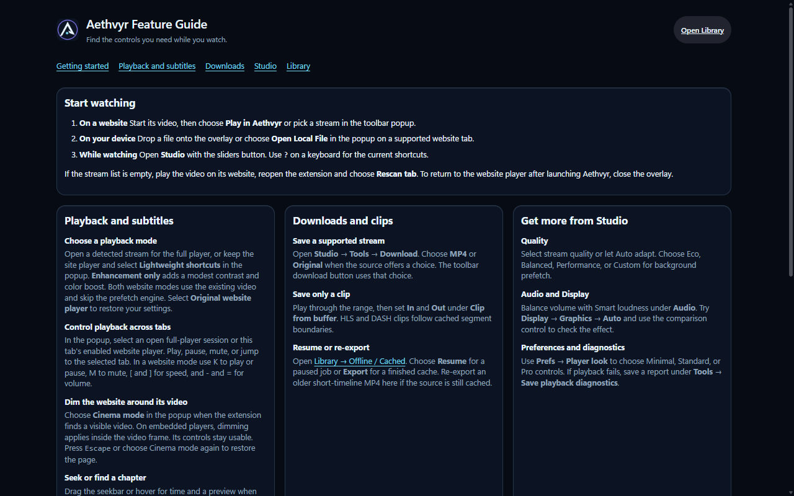

<div align="center">

<picture>
  <source media="(prefers-color-scheme: dark)" srcset="assets/brand/icon.svg">
  
</picture>

# Aethvyr

*Experience the unseen.*

**A privacy-first video player for the web with adaptive buffering, optional GPU enhancement, and a personal library.**


[Features](#features) · [Install](#install) · [Usage](#usage) · [Docs](#documentation) ·
[Build from source](#build-from-source) · [Security assessment](docs/PHASE3.md) · [Architecture report](docs/PHASE2.md) · [Phase 1 brand report](docs/PHASE1.md) · [Foundation audit](docs/FOUNDATION.md) · [Roadmap](docs/ROADMAP.md) · [Privacy](PRIVACY.md) · [Contributing](CONTRIBUTING.md)

</div>

---

[Watch the desktop playback demo](docs/media/playback-demo.webm)

## What it does

Open a detected web stream or drop a local video into the same Aethvyr player. Your usual
controls stay close, with advanced tools in Studio.

- **Adaptive buffering** adjusts prefetch workers to the stream and shares a background connection budget across tabs.
- **Optional GPU enhancement** offers device-aware Auto, Detail sharpening, Compression cleanup, Anime4K, and Anime4K High.
- **Personal library** brings together Continue Watching, collections, bookmarks, and categories for anime, donghua, cartoons, movies, and series.
- **Offline / Cached** keeps export progress so interrupted downloads can resume from committed chunks.

Everything runs locally in your browser. Aethvyr has no servers, no accounts, no analytics and
no remote code. See [PRIVACY.md](PRIVACY.md).



*Edge screenshot captured with a generated local test clip.*

## Try it in a minute

| What you want to do | Where to find it |
| --- | --- |
| Watch a website video | Start the site video and choose **Play in Aethvyr** or select the stream in the popup. |
| Watch a local file | Choose **Open Local File** in the popup on a website tab, or drop the file into the overlay. |
| Improve picture or audio | Open **Studio → Display → Graphics** or **Studio → Audio**. |
| Find captions, a transcript, or a chapter | Open the captions button for tracks and transcripts. Open **Studio → Tools** for chapters. |
| Download or save a clip | Open **Studio → Tools** for format and clip controls. Find paused and completed exports in **Library → Offline / Cached**. |
| Learn the controls | Open **Feature guide** from the popup or Studio. Press `?` in the player for keyboard shortcuts. |

<details>
<summary>See the in-extension Feature Guide</summary>



</details>

## Features

| Area | Highlights |
|------|-----------|
| **Detection** | HLS (`.m3u8`), DASH (`.mpd`) and direct files (MP4/WebM/…) found via network sniffing, `fetch`/XHR hooks, Web Workers (including `blob:` workers), `<video>`/`<source>` scanning and MSE detection, in every frame including cross-origin embeds. Ads and segment playlists are filtered out. |
| **Playback** | Shaka Player 5 (bundled, never loaded from a CDN). muted-autoplay fallback with one-tap unmute, auto-resume per video, remembered volume/speed/quality/audio and subtitle language, per-site profiles, auto-replace on chosen sites. |
| **Pre-buffer engine** | Background service worker downloads ahead with 2–8 adaptive workers, a byte-range accelerator, retries with backoff, an IndexedDB cache read zero-copy by the player, its own ABR, and a live DVR (default 30 min). |
| **GPU enhancement** | Device-aware Auto, Detail sharpening, Compression cleanup, two Anime4K presets, Color Studio, and an original-versus-enhanced comparison. |
| **Controls** | Configurable double-tap zones (left/centre/right), swipe for volume, brightness and scrubbing, long-press 2×, pinch zoom, mouse wheel and middle click, remappable keyboard shortcuts, frame stepping, A-B loop, zoom/pan/rotate/mirror, aspect presets, seek previews generated for plain video files, Picture-in-Picture with subtitles. |
| **Subtitles** | Site subtitles captured automatically (network, `<track>`, in-memory text tracks), SRT/VTT/ASS files, dual subtitles, sync to the next spoken line, timing speed, pause on hover, click to copy, searchable transcripts, and styling including dyslexia-friendly fonts. |
| **Audio** | Smart loudness normalization, boost up to 300%, presets (voice, bass, night) and 5-band EQ, A/V delay, pitch-preserving speed, mono/left/right channel routing, audio-only battery saver. |
| **Downloads** | HLS and DASH VOD to a single **MP4** (TS→fMP4 remux, audio merged) or the original format, A–B clips, live recording, DVR save, PNG snapshots and frame-burst contact sheets. External handoff to PotPlayer, VLC, mpv, IINA or an Android app, or copy a ready `yt-dlp`/`ffmpeg` command with the right headers. |
| **Player look** | Five skins (Glass, Cinema, Theater, draggable Floating pill, Compact), Minimal / Standard / Pro controls (frame step, A–B loop, snapshot, one-click EQ and GPU), chapter-segment or loudness-heatmap seek bar, bar thickness, background darkness, and per-button show / hide and order. |
| **Local files** | Drag-and-drop, video and folder selection, naturally sorted playlists, sidecar subtitles, and file-handle resume on compatible Chromium browsers. |
| **Library and sync** | Continue Watching, artwork, collections, favorites, and opt-in browser-account sync for settings, watch positions and bookmarks. |
| **Diagnostics** | Export a local playback report with startup time, buffer history, frame counts and error codes. |
| **Accessibility** | Full keyboard operation, screen-reader announcements, focus management, high-contrast mode, reduced motion, interface scaling (85–150 %), simple mode. |

The full tour is in **[docs/USER_GUIDE.md](docs/USER_GUIDE.md)**.

## Install

The versions below are manifest targets. Desktop verification covers playback and in-place upgrades on Edge 158 and upgrade and private-history checks on Firefox 160. Android and the minimum-version targets still need device testing.

| Browser | How |
|---------|-----|
| Chrome, Edge, Brave, Kiwi (Chromium 111+) | Chrome Web Store *(link added on release)*, or load `dist/chrome` unpacked (see below) |
| Firefox desktop and Firefox for Android 128+ | addons.mozilla.org *(link added on release)*, or load `dist/firefox` as a temporary add-on |

**Load unpacked (Chromium):** `chrome://extensions` → enable *Developer mode* → *Load unpacked* →
choose `dist/chrome`.

**Temporary add-on (Firefox):** `about:debugging#/runtime/this-firefox` → *Load Temporary Add-on…*
→ choose `dist/firefox/manifest.json`. Firefox asks you to grant site access for MV3 add-ons: use
**Allow access to websites** in the Aethvyr popup.

## Usage

1. Open a page with a video and start it once if it does not autoplay.
2. Click the **"Play in Aethvyr"** pill on the video, or open the toolbar popup and pick a stream.
3. The player opens over the site's video. Press <kbd>?</kbd> for all shortcuts and open
   **Studio** (the sliders button) for quality, audio, display, tools and preferences.
4. **Close** restores the site's own player.

Want a site to always open in Aethvyr? Turn on **Always play in Aethvyr** for that site in the popup.

## Documentation

| Document | Contents |
|----------|----------|
| [User guide](docs/USER_GUIDE.md) | Every feature, gesture and shortcut, Studio tabs, downloads, GPU presets |
| [Settings reference](docs/SETTINGS.md) | Every stored setting with defaults, ranges and migrations |
| [Architecture](docs/ARCHITECTURE.md) | Components, message protocol, transport, cache, ABR, export and GPU pipelines |
| [Development](docs/DEVELOPMENT.md) | Build, lint, debug, test and the Chrome Web Store / AMO release checklist |
| [Troubleshooting](docs/TROUBLESHOOTING.md) | Error codes (1001, 1002, 3016, 6xxx…), DRM, fullscreen, detection problems |
| [Permissions](docs/PERMISSIONS.md) | Why each permission is needed (store justification text) |
| [Store listing](docs/STORE_LISTING.md) | Copy-ready AMO and Chrome Web Store text, reviewer notes and form answers |
| [Privacy policy](PRIVACY.md) · [Security](SECURITY.md) · [Changelog](CHANGELOG.md) · [Contributing](CONTRIBUTING.md) | |

## Build from source

Requirements: **Node.js 18+**.

```bash
npm ci               # install the locked dependencies
npm run build        # dist/chrome and dist/firefox
npm run lint         # ESLint
npm test             # regression suite
npm run package      # store zips: dist/aethvyr-<browser>-<version>.zip
```

Other scripts: `npm run build:chrome`, `npm run build:firefox`, `npm run watch` (rebuild on save).
Always load the **built** folder; the sources need the build step to get Shaka and the
browser-specific manifest. Details in [docs/DEVELOPMENT.md](docs/DEVELOPMENT.md).

## Project layout

```
./   (repository root)
├── manifest.json            MV3 manifest (the build derives the Chrome and Firefox variants)
├── background/              Service worker / event page: the engine
│   ├── engine.js            detection, sessions, launch, transport, export, message router
│   ├── downloader.js        on-demand + prefetch loads, workers, retries, range accelerator
│   ├── abr-controller.js    throughput + buffer adaptive bitrate
│   ├── buffer-manager.js    IndexedDB segment cache (ring buffer, eviction)
│   └── hls-parser.js        M3U8 parser, AES-128 helpers
├── content/
│   ├── interceptor.js       MAIN world: fetch/XHR/Worker/MSE/DRM hooks, page-identity fetch proxy
│   └── sniffer.js           ISOLATED world: relay, DOM scan, subtitles, badge, player mounting
├── player/                  Extension page mounted as an iframe over the site's video
│   ├── player.html / player.js   bootstrap + engine port (auto-reconnect, request replay)
│   ├── player-ui.js         the player: UI, Shaka integration, gestures, subtitles, audio, tools
│   ├── shader-pipeline.js   WebGL2 enhancement presets + thermal guard
│   └── mp4-mux.js           TS→fMP4 remux and audio/video merge for downloads
├── popup/                   Toolbar popup: streams, telemetry, site settings
├── common/shared.js         Settings schema/migration, URL classification, binary codec
└── scripts/                 build.js, package.js
```

## Limitations

- **DRM** (Widevine, PlayReady, FairPlay) cannot be played or saved. Aethvyr detects it and says
  so instead of failing silently. YouTube and most paid services fall in this group.
- **Signed links expire.** Many sites sign stream URLs for minutes. Aethvyr switches to a newer
  link when the page requests one; otherwise reload the page and open the player again.
- **DASH download** covers on-demand streams: MP4 DASH becomes one `.mp4`; WebM (VP9) DASH is saved
  as the original video and audio files. Live DASH cannot be saved.
- A site's **Content Security Policy** or a sandboxed embed can forbid full screen; Aethvyr then
  fills the browser window instead.
- **GPU enhancement** needs WebGL2 and cannot read cross-origin direct files served without CORS.

## Responsible use

Aethvyr is a player and a personal download tool. Only download content you have the right to
keep, and respect each site's terms of service and your local copyright law. Aethvyr does not
circumvent DRM and never will.

## License

[MIT](LICENSE). Bundled [Shaka Player](https://github.com/shaka-project/shaka-player) is Apache-2.0;
its license ships in every build as `lib/SHAKA-LICENSE.txt`. The Anime4K shaders
([bloc97/Anime4K](https://github.com/bloc97/Anime4K) v4.0.1) are MIT; their license ships as
`player/ANIME4K-LICENSE.txt`.
